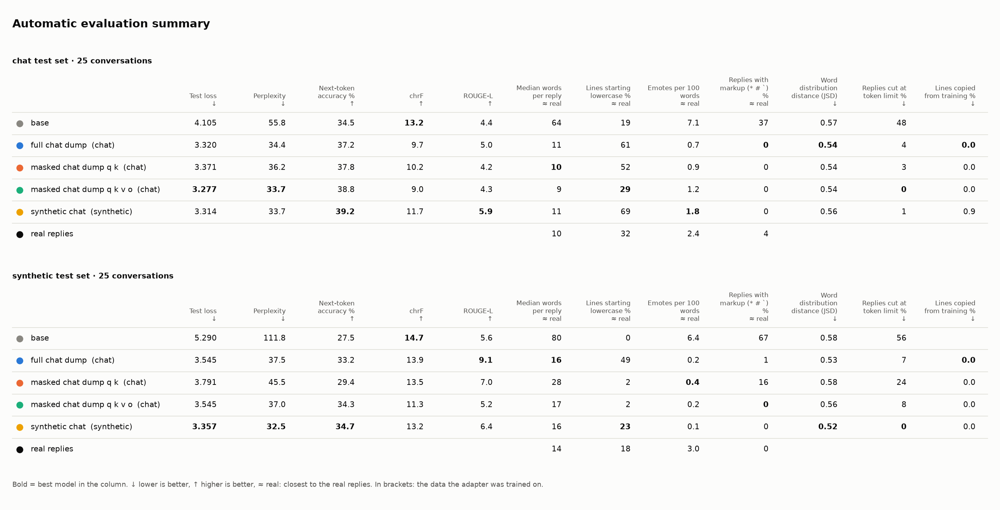

# WhatsAppFriend
Short experiments, aimed at learning how to finetune Bielik-4.5B-v3.0-Instruct to imitate a fren.

# Project aim
After a few years in game development, I am trying to break into the AI dev space. I have decided that in order to do this, the best way would be to have at least two basic projects to present: [Grounded RAG chatbot](https://loremaster.up.railway.app/), and fine tuning an open weights model to sound more like a person. Due to some slight paranoia over privacy protection, no cloud-based models were used in samples treatment or creation of the synthetic datasets. They did help with scripting, though. That constraint, paired with RTX 2090, is probably the biggest handicap of the project. 

# Simillar attempts
The style cloning was of course done many times, some as one-off projects [1](https://github.com/francescobrigante/Digital-Self-Replica) [2](https://github.com/obattisha/omargpt), some as a continous hobby effort [3](https://github.com/NotYuSheng/Doppelganger). I have not found a simillar one specifically for Polish. 

# Project data
The initial dataset consists of 1,436 messages. All the messages are in Polish. The subjects of the messages are mostly everyday check-ins, there is almost no long-form answers. It is very likely that one thought is split over a few consecutive messages. In training data, those few messages are merged into one long message. 

## A word on test set separation
The test and eval set separation was, arguably, one of the weaker points of the experiment. As test replies from the synthetic set were taken out after the set was generated. If ran again, the test and eval replies should be taken out before the synthetic dataset is generated, because it was quite hard to untangle them later on. The reason I left it is because for a surprisingly huge amount of conversations Bielik failed to generate a good synthetic question.

# Detailed prompt approach
The natural benchmark for my LoRA approach would be to try a detailed system prompt, with few shot examples sprinkled in. Here is the example prompt. It is to be noted that the system prompt for all generations is much more compact. This approach appears in the end tests as detailed_system_prompt_model

# Naive approach
The first approach was to just dump the conversations into the LoRA trainer, without masking the speaker and user turns. The conversations are sliced into a rolling window on length 4. That model was called full_chat_dump_model and the hyperparameters used are: 
	gradient_accumulation_steps=8,
    num_train_epochs=2,
    learning_rate=8e-5,
	LORA_R = 4
	LORA_A = 8
	TARGET_MODULES = [
        "q_proj",
        "k_proj",
        "v_proj",
        "o_proj",
	]

# Masking the user turns
The second approach masks the user turns, leaving only the last answer to compute the model loss. The LoRA was trained in two variants: q_proj and k_proj only, and all 4 projections. The reason I meddled with projections so much was because I saw some overfitting during the initial experiments. The models were called masked_chat_dump_q_k_v_o_model, and masked_chat_dump_q_k_model. 

# Reverse instructions
As explained in [This paper](https://arxiv.org/abs/2304.08460), the next logical step would be to turn this data into the Q&A format, typical of chatbot interactions. For the instruction generation, a slightly more capable Bielik-Minitron-7B-v3.0-Instruct was used. Bielik-4.5B-v3.0-Instruct was tried, but it refused to give NULL answers when unsure about the contents of the conversations, often repeating the questions provided to it in the prompt. The synthetic generation was run on a rolling windows of 2, 4 and 6 speaker turns, and then the non-null QA pairs were combined. 

# Overfitting
The tests ran on two epochs, and while the eval/test loss did not point to overfitting, there was also little indication that more training can lead to better results.

# Grading the models:

## Human grading:
49 example questions were generated for the model, and then sent as a survey to my friends. The clear winner happened to be the masked_chat_dump_q_k_v_o_model. 

